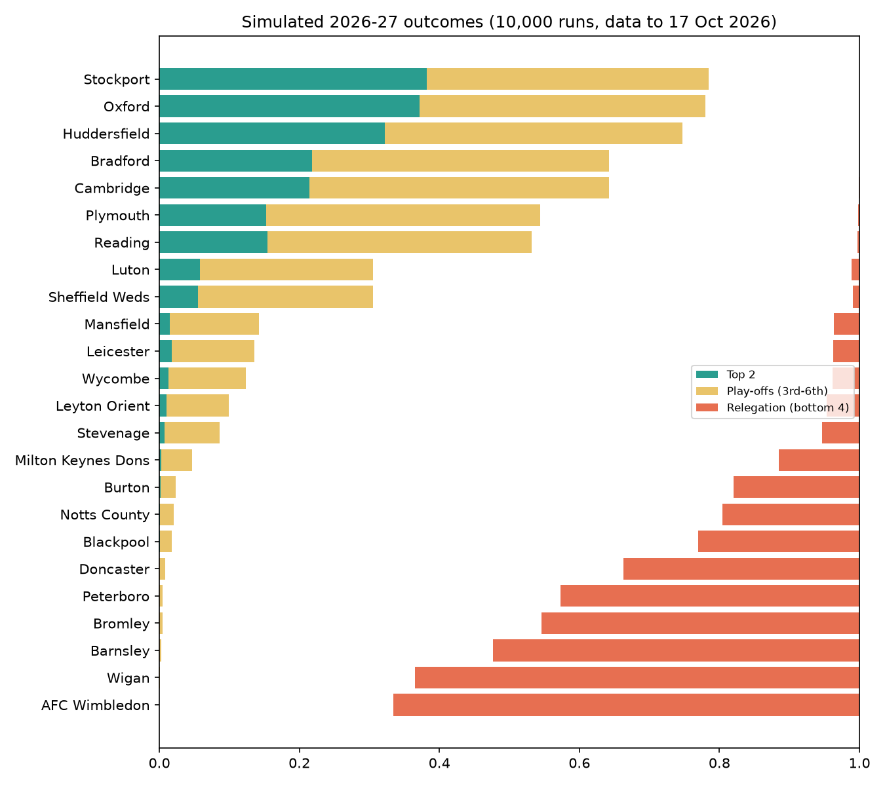
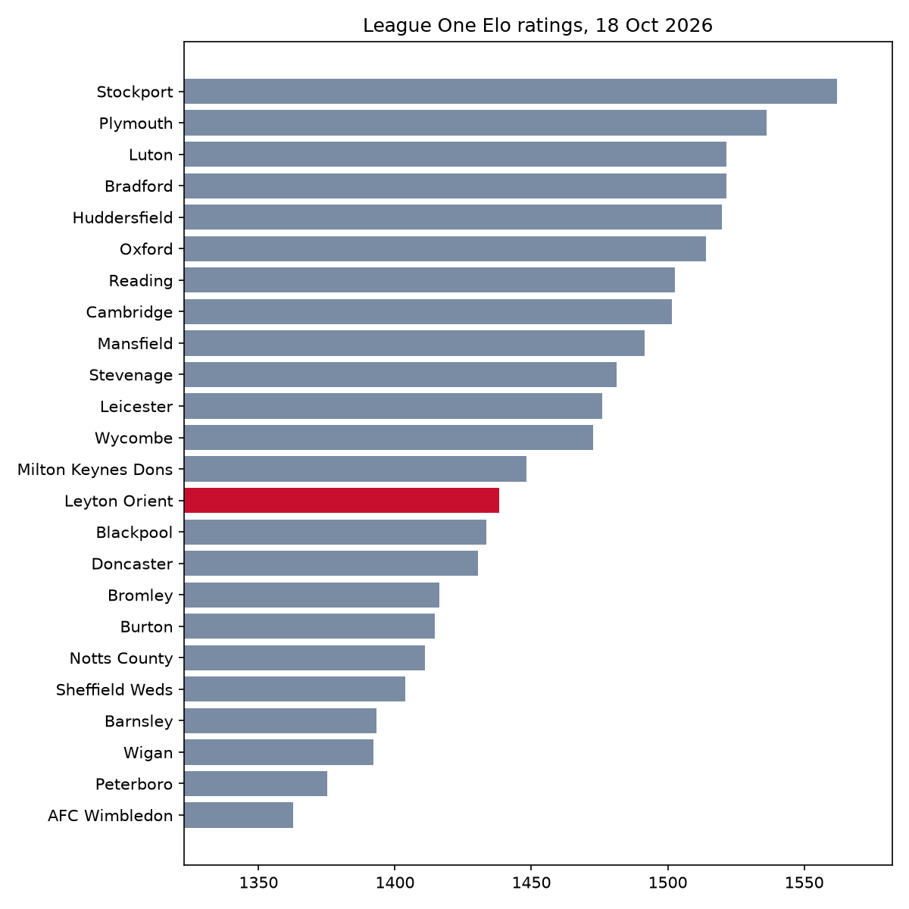
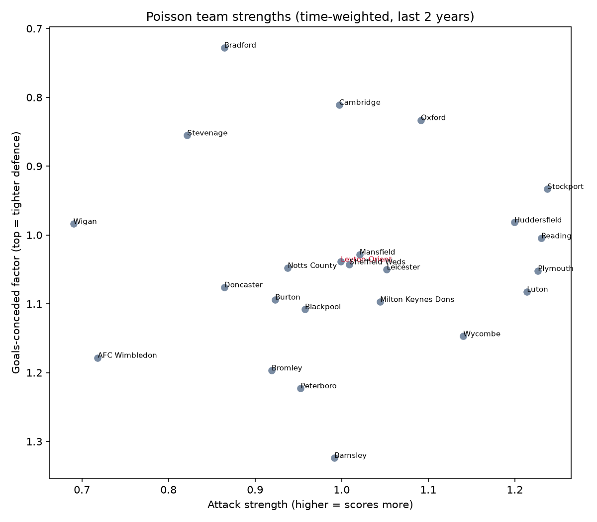
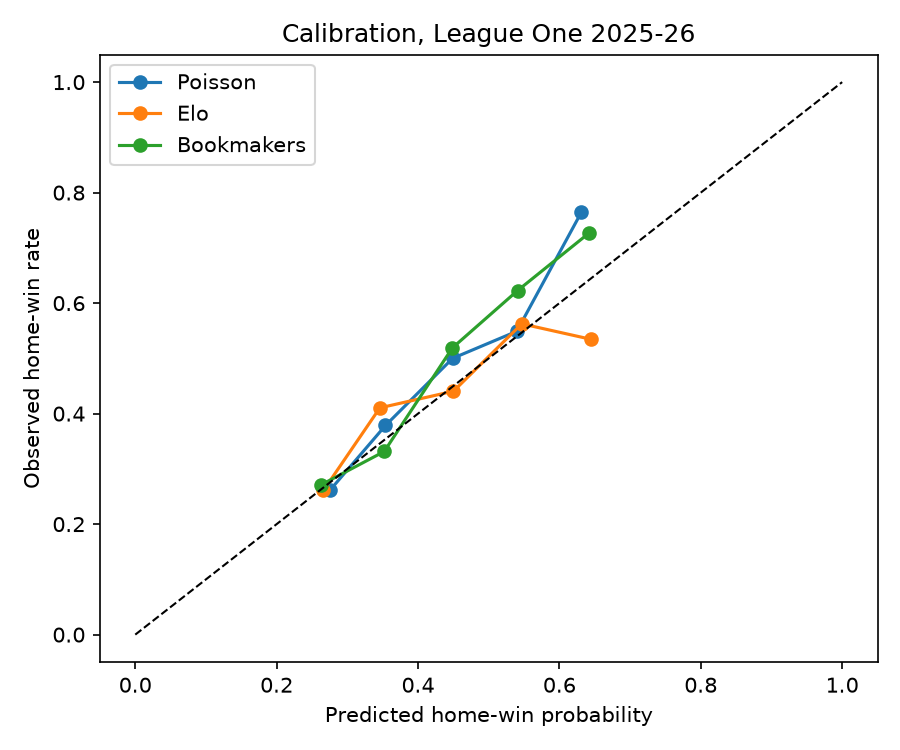
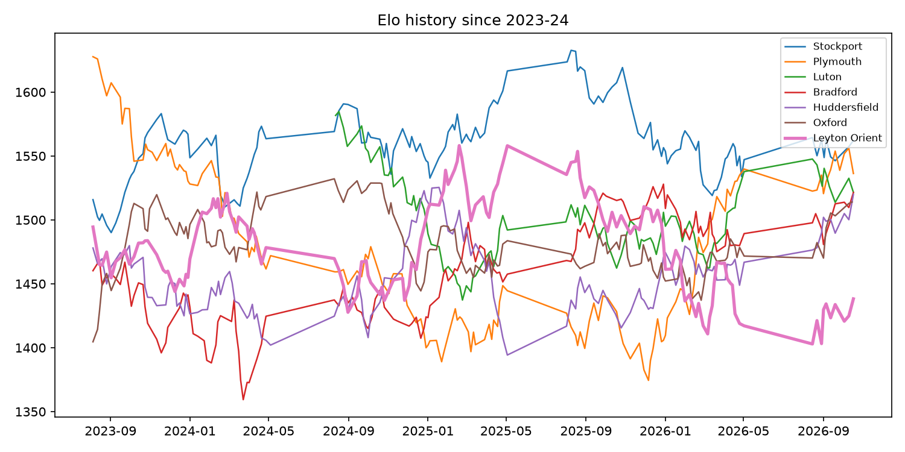

# League One match forecaster: Elo + Poisson models with a weekly-updating dashboard

Predicts EFL League One results and simulates the rest of the season. Two classic football models
(an Elo rating and a time-weighted Poisson goals model) are built from real results, backtested against
bookmaker odds, and served in a Streamlit dashboard. A GitHub Actions workflow refreshes everything every Monday.

Author: Anthony Adusei-Poku ([@anthony07-max](https://github.com/anthony07-max))



## Key findings (results to 17 October 2026)

**Backtest on the full 2025-26 League One season (552 matches, no look-ahead):**

| Model | Log loss | Brier | Accuracy |
|---|---|---|---|
| Base rates (always the historical H/D/A split) | 1.065 | 0.643 | 46.0% |
| Elo (goal-difference weighted) | **1.037** | **0.622** | 47.8% |
| Poisson (time-weighted, refitted weekly) | 1.044 | 0.627 | 47.8% |
| Bookmaker average (implied, margin removed) | 1.020 | 0.611 | 50.7% |

1. **Both models beat the naive baseline but not the market.** Elo closes about 60% of the gap in log loss between
   base rates and the bookmakers. That's normal: odds include team news, which results data doesn't have.
2. **Linking divisions matters.** Fitting only League One gave a newly relegated Sheffield Wednesday a 77% title chance,
   based on stale 2022-23 ratings. Adding Championship and League Two results (11,699 matches) lets ratings
   carry across promotion and relegation, and it also improved the backtest.
3. **The 2026-27 title race is open.** After about 10 games, Stockport (22%), Oxford (21%) and Huddersfield (17%) lead
   the title odds, and no team has better than a 38% chance of automatic promotion.
4. **Leyton Orient** (14 pts from 10 games) are projected for about 62 points and 12th to 13th place, with a 9% play-off
   chance and a 5% relegation risk.
5. Across League One since 2019, 43.5% of matches are home wins and 25.3% are draws.

| | |
|---|---|
|  |  |
|  |  |

## Method
- **Elo:** K=20, a 60-point home advantage, a goal-difference multiplier, and new teams starting at 1450. H/D/A probabilities
  come from the expected score, with a draw share that shrinks as matches get more one-sided.
- **Poisson:** log-linear team attack and defence strengths plus home advantage (`sklearn.PoissonRegressor`), fitted on the last
  2 years with a 180-day half-life weighting. Scorelines are independent Poissons.
- **Season simulation:** 10,000 Monte Carlo runs of every unplayed home/away pairing, using Poisson goal rates.
- **Limitations:** no team news, injuries or transfers. Unplayed fixtures are inferred from the double round-robin rather
  than the official calendar. Any points deductions are not applied.

## Data sources
- [football-data.co.uk](https://www.football-data.co.uk/englandm.php): English results and average closing odds,
  Championship (E1), League One (E2) and League Two (E3), 2019-20 to 2026-27. Free for non-commercial use.

## Project structure
```
src/download.py      # fetch season CSVs into data/raw/
src/clean.py         # combine into data/processed/matches.csv
src/models.py        # Elo and Poisson models
src/analysis.py      # backtest, ratings, season simulation, charts, key_findings.json
app/streamlit_app.py # dashboard: simulation, match predictor, ratings, backtest
tests/               # pytest unit tests
.github/workflows/weekly_update.yml  # Monday refresh + commit
```

## How to run
```bash
python -m venv .venv && source .venv/bin/activate
pip install -r requirements.txt
bash run_pipeline.sh          # download -> clean -> analysis (about 2 minutes)
pytest -q
streamlit run app/streamlit_app.py
```
